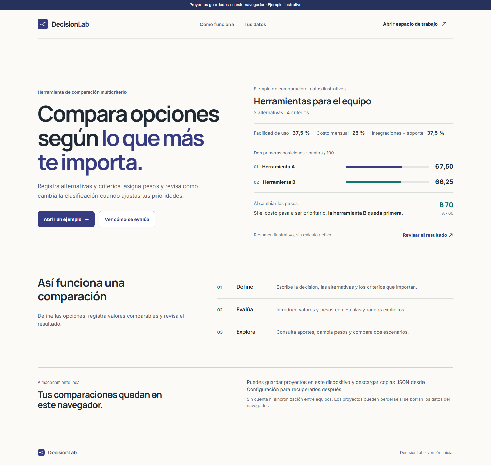

# DecisionLab

Aplicación web para comparar alternativas mediante criterios y pesos definidos por la persona que decide. Ayuda a ordenar una elección, revisar cómo se obtuvo cada puntuación y comprobar si el resultado cambia al modificar las prioridades. Todo funciona en el navegador; no hay cuenta, servidor propio ni base de datos remota.

**Demo pública:** pendiente de publicación.



## Qué permite hacer

- Crear, editar, duplicar, buscar y eliminar proyectos; registrar de dos a cinco alternativas y de dos a ocho criterios.
- Evaluar cada alternativa con una escala entera de 0 a 5 o con un valor numérico dentro de un rango y sentido favorable definidos.
- Asignar pesos, consultar la clasificación y el aporte de cada criterio, y comparar un escenario alternativo de prioridades.
- Guardar automáticamente los proyectos en IndexedDB, importar y exportar copias JSON, y abrir un informe imprimible.
- Probar un ejemplo ilustrativo completo sin presentarlo como un proyecto propio.

Las puntuaciones expresan las preferencias y datos introducidos. No constituyen una recomendación objetiva.

## Capturas

| Vista                    | Captura                                                                                                                            |
| ------------------------ | ---------------------------------------------------------------------------------------------------------------------------------- |
| Landing móvil            | [320 px](docs/evidence-12/landing-320.png)                                                                                         |
| Dashboard                | [Escritorio](docs/audit-11A/dashboard-1440.png)                                                                                    |
| Alternativas y criterios | [Alternativas](docs/screenshots/phase-10C-alternatives-desktop.png) · [Criterios](docs/screenshots/phase-10C-criteria-desktop.png) |
| Evaluación               | [Escritorio](docs/screenshots/phase-10D-evaluation-desktop.png)                                                                    |
| Resultados               | [Escritorio](docs/screenshots/phase-10E-results-desktop.png) · [Móvil](docs/screenshots/phase-10E-results-mobile-320.png)          |
| Escenarios               | [Escritorio](docs/screenshots/phase-10F-comparison-desktop.png)                                                                    |

Estas capturas usan datos ilustrativos. Las vistas de proyectos y resultados reales se alimentan de IndexedDB y del motor de evaluación.

## Inicio local

Requiere Node.js 24 o superior y npm. Para las pruebas de navegador locales se usa Google Chrome; en CI se instala Chromium con Playwright.

```sh
npm ci
npm run dev
```

Abre la dirección que muestra Vite. La landing está en `/` y el espacio de trabajo en `/app/`. Las rutas del espacio de trabajo usan fragmentos (`/app/#/project/:id/results`), por lo que admiten recarga y enlaces directos en alojamiento estático.

```sh
npm run check       # ESLint, Prettier, Vitest y compilación
npm run test:smoke  # pruebas básicas de rutas y renderizado
npm run test:e2e    # operaciones reales en el navegador
npm run build       # genera dist/
```

## Cálculo

Cada valoración de 0 a 5 se normaliza como `valor / 5 × 100`. Un criterio numérico entre `mínimo` y `máximo` se normaliza como `(valor − mínimo) / (máximo − mínimo) × 100` si un valor mayor es mejor, o `(máximo − valor) / (máximo − mínimo) × 100` si uno menor es mejor. Los pesos no negativos se convierten en proporciones dividiendo cada uno por su suma positiva. La puntuación de una alternativa es la suma de `valor normalizado × proporción` de sus criterios. Se clasifica con la precisión calculada y se redondea únicamente para mostrar. Los empates exactos comparten posición.

El ejemplo aprobado contiene tres alternativas y cuatro criterios. Sus resultados base son A 67,50; B 66,25; C 46,25. Al priorizar el costo en el escenario alternativo, B obtiene 70,00 y pasa al primer lugar. Consulta [modelo y fórmulas](docs/DOMAIN.md) y [escenarios](docs/SCENARIOS.md).

## Organización

- `src/domain`: modelo, validación, operaciones y cálculo independiente de la interfaz.
- `src/data`: IndexedDB, repositorio y formato de respaldos.
- `src/app`: rutas, estado y navegación.
- `src/features`: proyectos, asistente, evaluación, resultados, escenarios, intercambio e informe.
- `src/landing`, `src/shared`, `src/styles`: landing, componentes, ejemplo y diseño.
- `tests`, `scripts`, `docs`: pruebas, verificaciones y decisiones documentadas.

HTML5, CSS3, JavaScript con módulos ES y Vite. El proyecto no usa framework de interfaz ni backend. [Arquitectura](docs/ARCHITECTURE.md) · [Persistencia](docs/PERSISTENCE.md) · [Informe](docs/REPORT.md).

## Datos y límites

IndexedDB guarda los proyectos **en este navegador y en este origen**. Abrir la aplicación publicada no traslada automáticamente los datos creados en local. Borrar los datos del sitio puede eliminar proyectos; la exportación JSON permite conservar una copia e importarla en otro navegador o dispositivo. No hay cuenta ni sincronización. El sitio solicita Inter y Manrope a Google Fonts, de modo que no se promete funcionamiento completamente sin conexión. El PDF generado por la impresión del navegador puede carecer de etiquetas estructurales; el informe HTML es la vía principal de lectura accesible.

El MVP admite un escenario alternativo por proyecto. [Respaldo e importación](docs/TRANSFER.md) · [Atribuciones](docs/ATTRIBUTIONS.md).

## Licencia

Pendiente de decisión antes de publicar el repositorio. La recomendación y las atribuciones se explican en [ATTRIBUTIONS.md](docs/ATTRIBUTIONS.md); aún no se ha añadido un archivo `LICENSE`.
